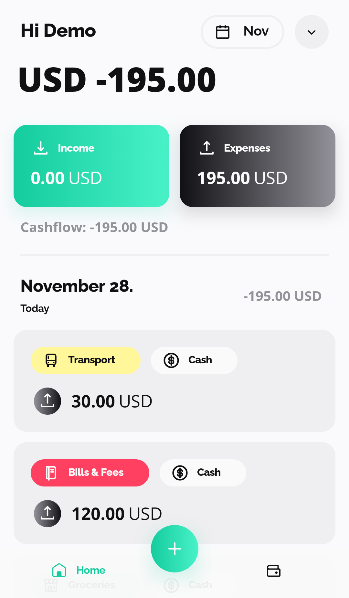
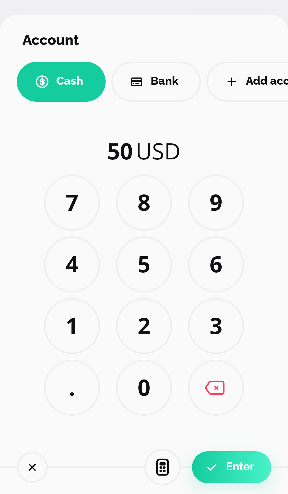
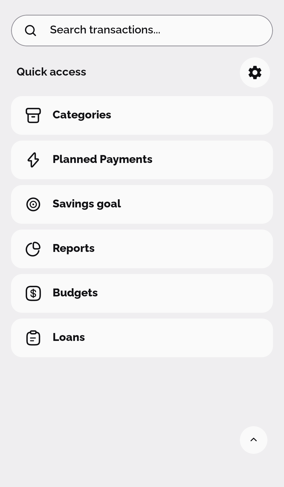
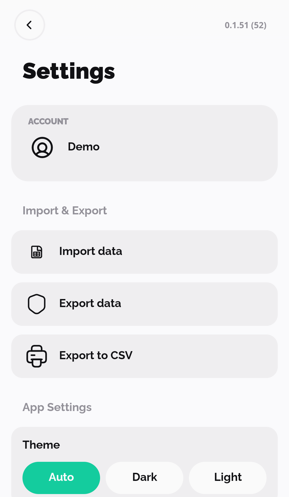

# Walletify

  

An offline money manager for Android. Your data stays on your device.

## Features
- No Firebase, no crash reporting, no telemetry, no polls. The only network use is the optional exchange-rate download.
- Error log in Settings (Copy and Clear), redacted, also records crashes. Nothing is sent anywhere.
- Its own application id (`com.ctmhod.walletify`), so it installs beside any other app.
- Release APKs are split per CPU architecture, plus one universal APK.

## Screenshots

Walletify v0.1.51 on an Android emulator, with demo data.

  
  
  
  

## Download
Requires Android 10 (API 29) or newer.
Open the latest release and start with `Walletify-vX-0-universal.apk` (works everywhere).
Smaller files: `arm64-v8a` (most phones and tablets), `armeabi-v7a` (old 32-bit devices), `x86_64` (emulators).

## License
GPL-3.0, see [LICENSE](LICENSE). Third-party credits: [THIRD_PARTY_NOTICES.md](THIRD_PARTY_NOTICES.md).

## Privacy
Walletify sends none of your data anywhere: no accounts, analytics, ads or crash reporting (exchange rates are downloaded on request). Everything is stored locally on your device.

## Developer
Telegram: [@ctmhod](https://t.me/ctmhod)
